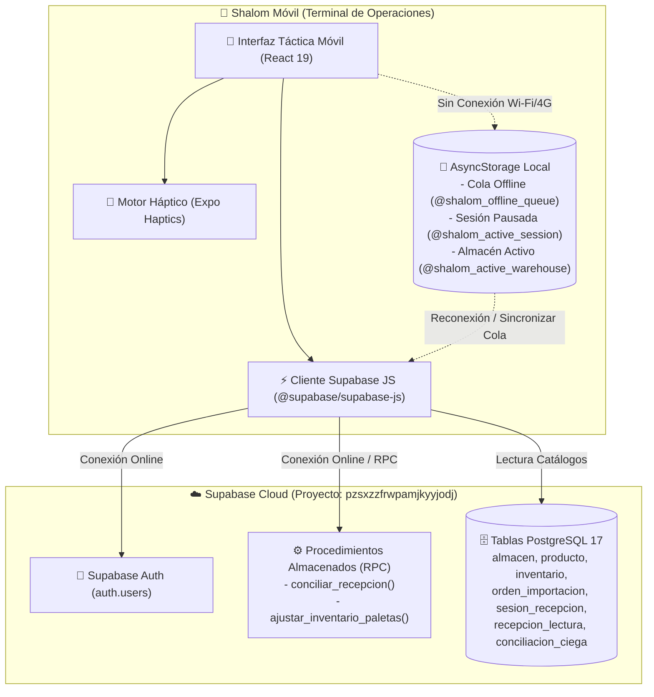
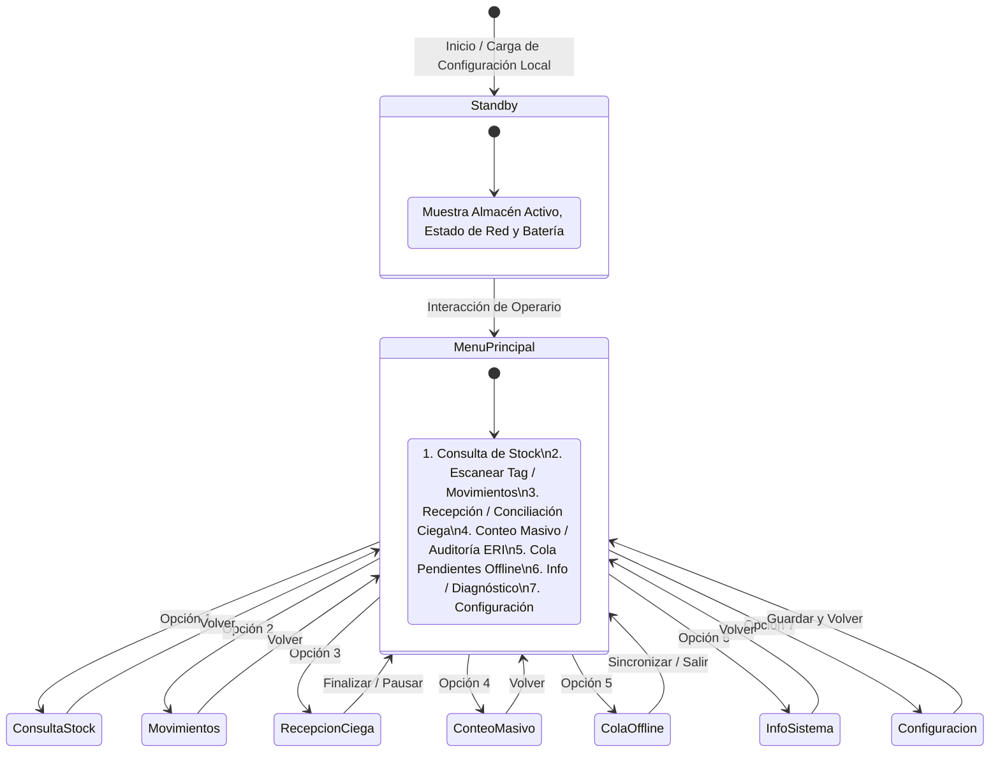

# Contexto Integral del Sistema — Shalom Móvil (Terminal Táctica de Operaciones)

> **Documento Fuente de Verdad y Memoria Viva de la App Móvil**  
> **Última actualización:** 2026-10-04  
> **Versión del Contexto:** 1.6.1  
> **Repositorio:** `shalom_movil`  
> **Proyecto Supabase ID:** `pzsxzzfrwpamjkyyjodj` (Región: `us-west-2`, PostgreSQL 17.6)  
> **Sistema Web Asociado:** `Importaciones_shalom` (MOD-04 / Recepción Táctica)

---

## 📌 Regla de Oro de Mantenimiento Obligatorio

> [!IMPORTANT]
> **REGLA PARA DESARROLLADORES Y ASISTENTES IA:**  
> Cada vez que se cree, modifique o elimine una pantalla, componente, servicio, hook, interacción de base de datos o lógica de almacenamiento offline en este repositorio (`shalom_movil`), **este archivo (`CONTEXTO_SISTEMA.md`) DEBE ser actualizado inmediatamente** en la sección correspondiente y en el historial de versiones (Changelog al final del documento). Esto garantiza que cualquier persona o IA cuente siempre con el contexto exacto y actualizado del sistema móvil sin alucinaciones.

---

## 1. Visión General del Proyecto

### 1.1 Misión y Propósito
**Shalom Móvil** es la aplicación táctica para dispositivos móviles (smartphones Android/iOS y colectores de datos industriales) que opera como la **Terminal de Campo** de **Importaciones Shalom**. 

Sustituye la dependencia de hardware microcontrolador dedicado externo (ESP32-S3 + lector SPI MFRC522), portando e implementando con fidelidad total el **mismo mapa de navegación operativo, lógica de negocio y arquitectura de recepción ciega** establecida en el proyecto matriz:
1. **Recepción Ciega en Muelle (RF-26):** Conteo sin sesgo visual de mercancía entrante, diferenciando **Paletas Completas** de **Cajas Sueltas (Puchos)**.
2. **Consultas Rápidas de Stock:** Inspección inmediata en pasillo mediante lectura de tags RFID/NFC, códigos de barras o búsqueda en catálogo.
3. **Movimientos Inmediatos:** Ejecución de despachos completos y retiros parciales (muestras, mermas, inspección) con afectación directa al stock central.
4. **Auditorías ERI (Exactitud de Registro de Inventario - RF-15):** Barrido de inventario físico en estantería para contraste con existencias teóricas.
5. **Resiliencia Operativa Offline:** Buffer y cola local de transacciones en almacenamiento seguro persistente (`AsyncStorage`) para trabajo en muelles o bodegas sin cobertura Wi-Fi/celular, con sincronización por lotes al recuperar señal.
6. **Experiencia Táctica:** Retroalimentación háptica sensorial (`expo-haptics`) en escaneos exitosos y alertas sonoras/vibratorias en duplicados o errores.

### 1.2 Stack Tecnológico

| Capa / Componente | Tecnología | Versión / Detalle | Función |
|---|---|---|---|
| **Framework Base** | React Native / Expo | Expo SDK 57 (`~57.0.26`), RN `0.86.3` | Núcleo de la aplicación móvil cross-platform |
| **Librería UI** | React | `19.2.3` | Componentes funcionales y hooks modernos |
| **Lenguaje** | TypeScript | `~6.0.3` | Tipado estricto en modo seguro |
| **Backend & Base de Datos** | Supabase JS Client | `@supabase/supabase-js` `^2.117.2` | Conexión con PostgreSQL 17.6, Auth y RPCs |
| **Persistencia Offline** | AsyncStorage | `@react-native-async-storage/async-storage` `2.2.0` | Cola de transacciones, sesión pausada y config |
| **Feedback Táctil** | Expo Haptics | `expo-haptics` `~57.0.3` | Vibración física en lecturas y confirmaciones |
| **Lector RFID Móvil** | React Native NFC Manager | `react-native-nfc-manager` `^3.17.5` | Lectura de tags RFID/NFC 13.56 MHz vía hardware nativo del teléfono |
| **Estilos** | React Native StyleSheet | Tema oscuro de alto contraste (`#0b0f19`, `#e52521`) | Legibilidad bajo sol o iluminación de almacén |

---

## 2. Arquitectura General y Flujo de Datos



---

## 3. Mapa de Navegación y Flujo Operativo Completo

El diseño de Shalom Móvil respeta y formaliza el flujo de 7 opciones definido originalmente en el diagrama de actividades (`mapa_de_navegacion.txt`):



### 3.1 Detalle de Módulos Operativos

#### 🔹 1. Consulta de Stock
- **Modalidad A (Escaneo Tag RFID/NFC/Barcode):**
  - Solicita acercar la etiqueta o enfocar el código.
  - Consulta `public.etiqueta_rfid` o `public.inventario` asociada al UID escaneado.
  - Presenta la ficha del producto: SKU, nombre, unidades por caja, camadas, cajas por camada, ubicación física y estado.
- **Modalidad B (Búsqueda en Catálogo):**
  - Filtra por el almacén activo.
  - Despliega lista de productos con existencias consolidadas y desglose de paletas/cajas.

#### 🔹 2. Escanear Tag / Movimientos Inmediatos
- Lectura del tag de la paleta/caja para identificar stock actual.
- Selección del tipo de movimiento:
  - **Despacho Completo:** Envío total a tienda, transferencia entre almacenes o baja por merma. Confirmación directa.
  - **Retiro Parcial (RF-24):** Para toma de muestras o bultos dañados. El operario ingresa la cantidad exacta a retirar, visualiza el saldo restante y registra el motivo.
- Envío transaccional en línea a Supabase (`movimiento` / `ajustar_inventario_paletas`). Si no hay red, la transacción se almacena en la cola offline local.

#### 🔹 3. Recepción y Conciliación Ciega RFID (RF-26) — Flujo Estructurado en 4 Pasos
El Módulo 3 opera mediante una arquitectura táctica secuencial e interactiva diseñada específicamente para terminales de campo y lectura de tags RFID:
1. **Paso 1: Selección de Orden y Regla de Estiba:**
   - Consulta de órdenes de importación pendientes en muelle y selección de SKU.
   - Despliegue de la ficha técnica de estibado ($Cajas = Cajas/Camada \times Camadas$ y unidades por caja).
   - Detección automática y opción de reanudar sesiones pausadas previas resguardadas en `@shalom_active_session`.
2. **Paso 2: Lectura Continua de Tags RFID (Hardware / Wedge / Simulación):**
   - **Antena / Radar Activo:** Panel sensorial de lectura de radiofrecuencia (13.56 MHz / UHF).
   - **Selector de Modo de Carga:**
     - 🟢 **Modo Paleta Completa:** Incremento unitario ($+1$ paleta estándar completa) con vibración háptica de éxito (`hapticSuccess()`).
     - 🟡 **Modo Cajas Sueltas (Puchos):** Activación de selector numérico y stepper táctico ($+1, +5, +10, +20$) para registrar la cantidad exacta de cajas o paquetes sueltos.
   - **Integración con Hardware Lector:** Input con procesamiento automático inmediato en evento `onSubmitEditing` (compatible con pistolas RFID Bluetooth, terminales industriales Zebra/Honeywell y emulación de teclado).
   - **Prevención de Duplicados en Tiempo Real:** Detección instantánea de tags ya leídos con alerta visual y vibración de advertencia (`hapticWarning()`) para evitar duplicidad de conteo.
   - **Buffer con Eliminación Individual:** Lista de tags registrados con hora exacta, tipo y botón de descarte individual (`🗑️`), recalculando automáticamente paletas y puchos sin reiniciar la sesión.
   - **Pausa de Recepción:** Permite suspender la sesión activa en `@shalom_active_session` de `AsyncStorage` en cualquier momento.
3. **Paso 3: Conciliación Ciega y Seguridad de Sesión Supabase:**
   - Resumen físico ciego consolidado (paletas completas, paquetes de puchos, cajas estimadas y tags únicos).
   - Protección Ciega (RF-26): Oculta deliberadamente la cantidad pedida para evitar sesgos en el muelle.
   - **Gestor de Autenticación Integrado:** Verifica la sesión con Supabase (`getSesionOperario()`). Si la terminal no tiene sesión abierta, despliega el formulario de acceso de Operario/Supervisor en la misma pantalla para autenticarse al instante sin perder los tags leídos.
4. **Paso 4: Subida, Conciliación Atómica y Registro en Supabase:**
   - Invoca `conciliarRecepcionEnSupabase`, ejecutando la RPC `conciliar_recepcion(p_id_orden, p_id_producto, p_id_almacen, p_lecturas)`.
   - **Afectación Atómica en Postgres:** Crea la `sesion_recepcion`, enrola las etiquetas en `etiqueta_rfid`, registra el detalle en `recepcion_lectura`, calcula la `conciliacion_ciega` (COMPLETA, SOBRANTES, FALTANTES), actualiza el stock en `inventario` y asienta el `movimiento`.
   - **Respaldo Resiliente Offline:** Si la terminal carece de conexión a la nube, la transacción se empaqueta con ID de idempotencia en `@shalom_offline_queue` para su posterior sincronización desde el Módulo 5.

#### 🔹 4. Conteo Masivo / Auditoría ERI (RF-15)
- Selecciona el almacén y pasillo/zona física.
- Activa modo de escaneo rápido acumulando tags únicos leídos.
- Al cerrar el barrido, envía el conteo físico para contrastar con las existencias registradas y generar el indicador porcentual de Exactitud de Registro de Inventario (ERI).

#### 🔹 5. Cola de Pendientes Offline
- Muestra el listado de transacciones pendientes almacenadas localmente.
- Opciones:
  - **Sincronizar:** Si hay red disponible, procesa cada elemento de la cola en orden FIFO contra los RPCs de Supabase y vacía los registros exitosos.
  - **Ver / Limpiar:** Inspección del contenido de la cola o borrado administrativo en caso de error descartable.

#### 🔹 6. Información y Diagnóstico del Sistema
- Telemetría en tiempo real:
  - Estado y latencia de conexión a Supabase (`ms`).
  - Nivel de batería del dispositivo móvil (`expo-battery` o estado nativo).
  - Identificador del dispositivo móvil y almacén activo configurado.
  - Versión instalada de la aplicación (`1.0.0`).

#### 🔹 7. Configuración
- Selección y cambio del **Almacén Activo de Trabajo** (almacenado en `@shalom_active_warehouse`).
- Configuración de intensidad de respuesta háptica (Ligera, Media, Fuerte, Desactivada).
- Selector de modo de escaneo preferido (Cámara, Lector Bluetooth acoplado, Entrada Teclado).

---

## 4. Persistencia Local y Esquema de Cola Offline

La persistencia offline se gestiona en `AsyncStorage` mediante claves estandarizadas:

| Clave de Almacenamiento | Propósito | Estructura de Datos |
|---|---|---|
| `@shalom_active_warehouse` | Almacén asignado al terminal | `{ "id_almacen": 1, "nombre": "Almacén Principal" }` |
| `@shalom_offline_queue` | Cola transaccional pendiente | Array de objetos `TransaccionOffline[]` |
| `@shalom_active_session` | Sesión de recepción pausada | `{ "orden": {...}, "id_almacen": 1, "lecturas": [...], "total_paletas_completas": N, "total_paquetes_puchos": N }` |
| `@shalom_haptic_enabled` | Preferencia de feedback háptico sensorial | `"true"` o `"false"` (boolean) |
| `@shalom_user_session` | Datos de sesión y token de operario | Objeto de sesión Supabase JWT persistente |

### Estructura de `TransaccionOffline`:
```typescript
export interface TransaccionOffline {
  id: string;               // UUID local autogenerado
  tipo_operacion: 'RECEPCION_CONCILIACION' | 'MOVIMIENTO_STOCK' | 'AUDITORIA_ERI';
  payload: any;             // Parámetros completos para invocar la API o RPC
  creado_en: string;        // Timestamp ISO 8601
  intentos_sincronizacion: number;
  ultimo_error?: string;
}
```

---

## 5. Integración con Supabase

### 5.1 Credenciales del Proyecto
- **Supabase URL:** Configurada en `.env` vía `EXPO_PUBLIC_SUPABASE_URL` (`https://pzsxzzfrwpamjkyyjodj.supabase.co`).
- **Supabase Anon Key:** Configurada en `.env` vía `EXPO_PUBLIC_SUPABASE_ANON_KEY`.
- **Cliente:** Inicializado en [`src/lib/supabase.ts`](file:///home/ludam/Importaciones/shalom_movil/src/lib/supabase.ts) utilizando `AsyncStorage` como motor de almacenamiento de sesión con refresco automático.

### 5.2 Procedimientos Almacenados (RPC) Invocados por la App Móvil
1. `conciliar_recepcion(p_id_orden, p_id_producto, p_id_almacen, p_lecturas)`:
   - Cierra la recepción ciega calculando sobrantes y faltantes de forma atómica bajo lock transaccional.
2. `ajustar_inventario_paletas(p_id_producto, p_id_almacen, p_paletas, p_puchos, p_motivo)`:
   - Aplica movimientos de inventario convirtiendo paletas completas y bultos parciales en unidades contables exactas.

### 5.3 Tablas de Supabase Consultadas y Actualizadas
- `public.almacen`: Catálogo de almacenes para selección activa.
- `public.producto`: Consulta de SKUs, reglas de empaque y especificaciones.
- `public.inventario`: Lectura de existencias y semáforo de reposición.
- `public.orden_importacion` y `public.detalle_orden`: Órdenes pendientes de recepción en muelle.
- `public.movimiento`: Registro de auditoría para cada transacción de despacho o ajuste.
- `public.etiqueta_rfid`: Asociación de tags RFID/NFC con paletas y lotes.

---

## 6. Estructura de Archivos del Repositorio `shalom_movil`

```
shalom_movil/
├── .env                       # Variables de entorno (EXPO_PUBLIC_SUPABASE_URL, ANON_KEY)
├── .gitignore                 # Exclusiones de Git (node_modules, .expo, etc.)
├── AGENTS.md                  # Protocolos obligatorios de desarrollo y pautas Expo SDK 57
├── app.json                   # Configuración del proyecto Expo / EAS Build
├── App.tsx                    # Orquestador principal táctico y enrutador de pantallas
├── assets/                    # Iconos y recursos visuales adaptativos
├── ACTUALIZACION_RPC_CONCILIAR_RECEPCION.sql # Script SQL con RPC conciliar_recepcion optimizada y unicidad RFID
├── ACTUALIZACION_RPC_MOVIMIENTOS_DESPACHOS.sql # Script SQL con RPC ejecutar_movimiento_despacho y regla de 1 pucho
├── CONTEXTO_SISTEMA.md        # [ESTE ARCHIVO] Fuente de Verdad y Memoria Viva
├── index.ts                   # Registro del root component de Expo
├── mapa_de_navegacion.txt     # Especificación original PlantUML del flujo táctico
├── package.json               # Dependencias (Expo 57, React 19, Supabase 2, Haptics)
├── SEMBRADO_Y_CORRECCION_SUPABASE.sql # Script SQL maestro para corrección y datos en Supabase
├── src/
│   ├── lib/
│   │   ├── haptics.ts         # Motor sensorial de vibración háptica configurable
│   │   ├── nfc.ts             # Lector de hardware RFID/NFC nativo para móvil
│   │   └── supabase.ts        # Cliente Supabase configurado con AsyncStorage
│   ├── screens/
│   │   ├── LoginScreen.tsx         # Gatekeeper de autenticación previa obligatoria
│   │   ├── SelectAlmacenScreen.tsx # Asignación y confirmación de almacén activo post-login
│   │   ├── StandbyScreen.tsx       # Pantalla de Reposo (Batería, Red, Almacén, Acceso)
│   │   ├── MainMenuScreen.tsx      # Menú Principal (8 opciones del mapa táctico)
│   │   ├── RecepcionCiegaScreen.tsx# MÓDULO 3: Recepción RFID en 4 vistas secuenciales
│   │   ├── ConsultaStockScreen.tsx # MÓDULO 1: Consulta Rápida de Stock y Catálogo
│   │   ├── MovimientosScreen.tsx   # MÓDULO 2: Despachos y Retiros Parciales (Regla de 1 Pucho)
│   │   ├── ConteoMasivoScreen.tsx  # MÓDULO 4: Conteo Masivo y Auditoría ERI (RF-15)
│   │   ├── ColaOfflineScreen.tsx   # MÓDULO 5: Cola de Pendientes Offline y Sincronización
│   │   ├── InfoSistemaScreen.tsx   # MÓDULO 6: Información, Diagnóstico y Latencia Cloud
│   │   ├── ConfiguracionScreen.tsx # MÓDULO 7: Configuración de Almacén, Háptica y Auth
│   │   └── HistorialScreen.tsx     # MÓDULO 8: Historial de Operaciones y Kardex en tiempo real
│   ├── services/
│   │   ├── movimientos.ts     # Integración Supabase RPC ejecutar_movimiento_despacho y Kardex
│   │   ├── recepcion.ts       # Integración Supabase RPC conciliar_recepcion y catálogo
│   │   ├── stock.ts           # Consultas RFID en Supabase (etiqueta_rfid, inventario, producto)
│   │   └── storage.ts         # Persistencia AsyncStorage (almacén, cola, sesión pausada)
│   └── types/
│       └── index.ts           # Definiciones TypeScript de entidades y navegación
└── tsconfig.json              # Configuración TypeScript estricta
```

---

## 7. Protocolo Obligatorio para Mantener este Archivo Actualizado

Cualquier agente inteligente o desarrollador humano que realice modificaciones en el repositorio `shalom_movil` debe seguir este checklist antes de concluir:

1. **¿Se creó o modificó una pantalla o componente de la app?**
   - Actualiza la sección **3. Mapa de Navegación y Flujo Operativo Completo**.
   - Actualiza el árbol de archivos en la sección **6. Estructura de Archivos**.
2. **¿Se agregaron nuevas claves a AsyncStorage o cambios en la cola offline?**
   - Actualiza la tabla y esquemas de la sección **4. Persistencia Local y Esquema de Cola Offline**.
3. **¿Se integraron nuevas tablas, columnas o llamadas RPC a Supabase?**
   - Actualiza la sección **5. Integración con Supabase**.
4. **¿Se agregaron o modificaron paquetes en `package.json` o variables en `.env`?**
   - Refléjalo en la tabla de **1.2 Stack Tecnológico** y en la sección de credenciales.
5. **Registrar el cambio en el Changelog:**
   - Añadir una nueva entrada en la sección **8. Historial de Versiones del Contexto**.

---

## 8. Historial de Versiones del Contexto (Changelog)

| Versión | Fecha | Autor / Agente | Resumen de Modificaciones |
|---|---|---|---|
| **1.6.3** | 2026-10-05 | Antigravity AI | **Módulo 2 (Movimientos y Despachos): Selector de Destino, Transferencia Inter-Almacén y Solución a `value too long for type character varying(100)`:**<br>- **Solución al Error de Longitud Varchar(100):** La columna `motivo` en la tabla `public.movimiento` poseía restricción `character varying(100)`, que colapsaba al registrar motivos largos con SKU y UIDs. Se actualizó [`ACTUALIZACION_RPC_MOVIMIENTOS_DESPACHOS.sql`](file:///home/ludam/Importaciones/shalom_movil/ACTUALIZACION_RPC_MOVIMIENTOS_DESPACHOS.sql) con `alter table public.movimiento alter column motivo type text;` y se aplicó truncamiento defensivo estricto `substring(... from 1 for 95)` en la RPC y en el cliente móvil (`slice(0, 80)`).<br>- **Selector de Destino de Almacén:** Carga dinámica de almacenes disponibles (`fetchAlmacenes`) con tarjeta táctica de ruta (`ORIGEN: Almacén Principal ➔ DESTINO: Tienda Central`). Modal interactivo para seleccionar la tienda, merma o almacén de llegada.<br>- **Modal de Confirmación Táctica:** Despliegue de modal con desglose completo antes de enviar (origen, destino, paletas afectadas, cajas, unidades descontadas y aviso de generación de pucho).<br>- **Transferencia Atómica en RPC:** Cuando el destino es otro almacén interno (`v_id_almacen_destino <> p_id_almacen`), la RPC descuenta el inventario del origen, incrementa automáticamente el inventario del destino y actualiza `id_almacen_actual` de la etiqueta en caso de despacho completo. |
| **1.6.2** | 2026-10-05 | Antigravity AI | **Corrección de Esquema en Consulta de Paletas en Bodega (Error `etiqueta_rfid.created_at does not exist`) y Blindaje de Kardex:**<br>- **Solución al Error 42703:** Retiro de la columna inexistente `created_at` en las consultas de `public.etiqueta_rfid` y `public.recepcion_lectura` dentro de `src/services/stock.ts`. Se sincronizó la lectura de marcas temporales con las columnas reales de PostgreSQL (`sesion_recepcion.fecha_finalizacion` / `sesion_recepcion.fecha_inicio`).<br>- **Resiliencia Defensiva en `fetchPaletasEnBodega`:** Soporte de filtrado flexible de almacén mediante `.or(\`id_almacen_actual.eq.${params.id_almacen},id_almacen_actual.is.null\`)` y fallback de recuperación automática sobre `public.recepcion_lectura` para que las paletas enroladas en recepción se muestren de forma inmediata y confiable.<br>- **Corrección de Esquema en Kardex (`src/services/movimientos.ts`):** Reemplazo de `created_at` por la columna real `fecha_hora` en la tabla `public.movimiento`, y ajuste de relación de usuarios a `usuario:id_usuario(nombre_completo)` evitando fallos en el Módulo 8 de Historial.<br>- **Script SQL de Migración (`ACTUALIZACION_COLUMNAS_Y_PALETAS.sql`):** Provisión de script para agregar columnas `created_at` en base de datos si se requiere auditoría nativa, y apertura de políticas RLS de lectura para terminales operarias. |
| **1.6.1** | 2026-10-04 | Antigravity AI | **Fase 3 de Módulo 1: Pestaña "Paletas en Bodega" (Inventario Físico de Tags RFID):**<br>- **Arquitectura de 3 Pestañas en `ConsultaStockScreen.tsx`:** Toggle superior entre `[📡 Escanear]` (Fase 1), `[📦 Catálogo]` (Fase 2) y `[📋 Paletas]` (Fase 3).<br>- **Servicio de Consulta de Paletas (`src/services/stock.ts`):** Función `fetchPaletasEnBodega()` que consulta `public.etiqueta_rfid` vinculada a `producto`, `regla_empaque` y `almacen`.<br>- **Filtros Tácticos por Tipo de Carga:** Filtro dinámico entre *Todas*, *Completas* y *Puchos* (permite identificar al instante cuál es la paleta pucho activa de cada SKU para su despacho prioritario).<br>- **Buscador en Vivo & Inspección Directa:** Buscador en memoria por UID de tag, SKU o nombre de producto. Cada tarjeta de paleta cuenta con el botón `[🔍 Inspeccionar ➔]` que salta automáticamente a la pestaña de escaneo con su ficha técnica detallada. Tipado estricto `PaletaBodegaItem` en `src/types/index.ts`. |
| **1.6.0** | 2026-10-04 | Antigravity AI | **Implementación Integral de Módulo 2 (Movimientos y Despachos) y Creación de Módulo 8 (Historial y Kardex):**<br>- **Módulo 2 (`MovimientosScreen.tsx`):**<br>&nbsp;&nbsp;1. *Lectura Continua NFC:* Detección automática en primer plano con el sensor del teléfono móvil (`startNfcSession`). Consulta en tiempo real en Supabase de la paleta y verificación de estado `ACTIVA`.<br>&nbsp;&nbsp;2. *Selector Táctico de Retiro:* Permite seleccionar entre *Retiro Completo* (despacho del tag completo) o *Retiro Parcial* (stepper numérico de cajas a retirar con recálculo automático de unidades y stock remanente).<br>&nbsp;&nbsp;3. *Regla de Oro de Almacén (Máximo 1 Pucho por Producto):* Al retirar parcialmente una paleta completa, esta pasa a estado `PUCHO`. Si el producto ya cuenta con una paleta pucho activa en bodega, el sistema bloquea la operación y despliega un modal de advertencia obligando a agotar primero el pucho existente antes de fraccionar una nueva paleta.<br>&nbsp;&nbsp;4. *Envío Atómico a Supabase:* Invocación de la RPC `ejecutar_movimiento_despacho` con actualización de inventario, cambio de estado de etiquetas e inserción en Kardex.<br>- **Módulo 8 (`HistorialScreen.tsx`):**<br>&nbsp;&nbsp;1. *Timeline Cronológico en Vivo:* Consulta de la tabla `public.movimiento` con tarjetas informativas por transacción, usuario responsable, SKU, cantidad (+/-) y motivo.<br>&nbsp;&nbsp;2. *Filtros Dinámicos:* Filtrado rápido por tipo de operación (*Todos*, *Ingresos*, *Despachos*, *Puchos/Retiros Parciales*) y por rango de fechas (*Hoy*, *7 Días*, *30 Días*, *Todo el Historial*).<br>&nbsp;&nbsp;3. *Navegación Táctica:* Incorporación de la opción 8.0 en el Menú Principal (`MainMenuScreen.tsx`) y enrutamiento en `App.tsx`. |
| **1.5.2** | 2026-10-04 | Antigravity AI | **Solución a PostgREST Schema Cache en `conciliar_recepcion` y Blindaje de Unicidad RFID de Alto Rendimiento:**<br>- **Solución al Error de Schema Cache:** Declaración de sobrecarga de funciones (overload) en PostgreSQL para admitir tanto 5 parámetros (`p_id_orden, p_id_producto, p_id_almacen, p_lecturas, p_id_transaccion_offline`) como 4 parámetros (`p_id_orden, p_id_producto, p_id_almacen, p_lecturas`), otorgamiento de permisos `EXECUTE` a `authenticated` y `anon`, y ejecución de `NOTIFY pgrst, 'reload schema'`.<br>- **Defensa Activa en Cliente Móvil (`src/services/recepcion.ts`):** Fallback automático inteligente que reintenta con 4 parámetros si PostgREST rechaza la firma de 5 parámetros.<br>- **Unicidad Física Estricta de RFID:** Un tag RFID no puede asignarse ni reutilizarse en ningún producto mientras se encuentre en estado `ACTIVA` en el almacén.<br>- **Arquitectura de Alto Rendimiento (Cero Sobrecarga):**<br>&nbsp;&nbsp;1. *Índice B-Tree en Base de Datos:* Creación de `create unique index if not exists etiqueta_rfid_uid_tag_uq on public.etiqueta_rfid (uid_tag)`, garantizando búsquedas en $O(\log N)$ (< 0.1 ms) sin escanear la tabla completa.<br>&nbsp;&nbsp;2. *Pre-validación Instantánea en Terminal Móvil (`RecepcionCiegaScreen.tsx`):* Consulta unitaria por índice en `procesarTagDetectado` al escanear cada tag vía NFC; si ya está activo, bloquea el enrolamiento de inmediato con feedback háptico de error y alerta modal.<br>&nbsp;&nbsp;3. *Validación Atómica en Lote en la RPC:* Verificación por subconsulta con operador de conjuntos `where e.uid_tag in (select trim(item->>'uid') from jsonb_array_elements(p_lecturas)) and e.estado = 'ACTIVA' limit 1`, garantizando integridad transaccional instantánea sin saturar el servidor ni descargar toda la base de datos a memoria. |
| **1.5.1** | 2026-10-04 | Antigravity AI | **Limpieza Integral de Interfaz: Eliminación de Mensajes de Consejo, Badges de Estado y Textos de Desarrollo en Vistas:**<br>- **Menú Principal (`MainMenuScreen.tsx`):** Retiro de la etiqueta `OPERATIVO 100%`, etiqueta `VACÍA` en la cola offline y eliminación de sufijos técnicos de requerimientos funcionales (`(RF-24)`, `(RF-26)`, `(RF-15)`). El menú ahora presenta un diseño corporativo limpio de producción.<br>- **Módulo 3 (`RecepcionCiegaScreen.tsx`):** Supresión de cuadros de consejo y banners informativos de desarrollo (`🔒 Recepción Ciega RF-26: La terminal oculta...`, `📱 EJECUTANDO EN EXPO GO (MODO SIMULACIÓN)...`, y `🛡️ Protección Ciega Activada (RF-26)...`). Limpieza del detalle de sesión del operario.<br>- **Login (`LoginScreen.tsx`):** Reemplazo del aviso técnico `🔒 Protección RLS Activa...` por una nota corporativa sobria de acceso restringido.<br>- **Módulos 2 y 4 (`MovimientosScreen.tsx` y `ConteoMasivoScreen.tsx`):** Supresión de sufijos de diseño `(RF-24)` y `(RF-15)` en títulos y botones de selección.<br>- **Módulo 1 (`ConsultaStockScreen.tsx`):** Títulos de filtros profesionalizados (`SELECCIÓN DE PRODUCTO`, `ALMACÉN`, `PERÍODO DE MOVIMIENTOS`) y retiro de menciones de demo/simulación en la UI. |
| **1.5.0** | 2026-10-04 | Antigravity AI | **Fase 2 de Módulo 1 (Consulta Manual por Catálogo, Filtro por Almacén y Rango de Fechas / Kardex):**<br>- **Arquitectura Dual por Pestañas:** Toggle superior en `ConsultaStockScreen.tsx` entre `[📡 Escanear Tag RFID]` (Fase 1) y `[📦 Catálogo y Filtros]` (Fase 2).<br>- **Buscador y Selector de Catálogo (`src/services/stock.ts`):** Función `fetchCatalogoProductosStock()` para listar productos activos de Supabase con filtrado dinámico en tiempo real por SKU o nombre.<br>- **Filtro Dinámico de Almacén:** Función `fetchAlmacenesStock()` para seleccionar entre *Todos los Almacenes* (resumen global consolidado) o almacenes específicos (*Almacén Principal*, *Tienda Central*, *Mermas*). Muestra desglose de unidades reales y requerimiento mínimo.<br>- **Filtro de Fechas & Kardex de Movimientos:** Función `consultarStockManualProducto()` que consulta la tabla `movimiento` en Supabase con rangos (*Hoy*, *Últimos 7 días*, *Últimos 30 días*, *Todo el Historial*). Muestra tipo de operación (`INGRESO_COMPLETO`, etc.), cantidad (+X u), fecha/hora exacta y motivo de la orden.<br>- **Equivalencias Logísticas Automáticas:** Cálculo en tiempo real de cajas y paletas estándar equivalentes según la regla de empaque del producto. Tipado estricto `ConsultaManualProductoResultado`, `StockAlmacenItem` y `MovimientoStockItem` en `src/types/index.ts`. |
| **1.4.0** | 2026-10-04 | Antigravity AI | **Fase 1 de Módulo 1 (Consulta de Stock por Escaneo RFID / NFC en Vivo):**<br>- **Servicio de Consulta RFID (`src/services/stock.ts`):** Función `consultarTagRfidEnSupabase(uid)` que busca en tiempo real en la tabla `etiqueta_rfid` vinculada a `producto`, `regla_empaque`, `almacen` e `inventario`. Incluye resolución retrospectiva en `recepcion_lectura` para obtener la orden de importación asociada.<br>- **Pantalla Táctica `ConsultaStockScreen.tsx`:** Integración de la antena NFC en primer plano (`startNfcSession` / ReaderMode) con retroalimentación háptica sensorial inmediata al detectar el tag. Soporta entrada por teclado manual y simulación táctica en Expo Go.<br>- **Ficha Táctica del Tag:** Despliegue visual del producto (SKU, nombre, categoría, unidad de medida), desglose exacto de la paleta/tag escaneado (si es Paleta Completa o Pucho, número de cajas y unidades exactas contenidas en este tag), almacén asignado, stock consolidado total en el almacén con semáforo (`VERDE`/`AMARILLO`/`ROJO`) y regla de estiba estándar. Tipado estricto `FichaTagRFID` en `src/types/index.ts`. |
| **1.3.3** | 2026-10-04 | Antigravity AI | **Idempotencia Transaccional en RPC `conciliar_recepcion` y Verificación Integral de Esquema Supabase:**<br>- **Idempotencia Activa en RPC:** Se vinculó el parámetro `p_id_transaccion_offline` tanto en la llamada directa (`conciliarRecepcionEnSupabase`) como en la sincronización en cola (`sincronizarColaOffline`). Con esto, PostgreSQL identifica transacciones previamente procesadas mediante el índice único `sesion_recepcion_id_transaccion_offline_uq`, evitando duplicaciones accidentales por reintentos de red.<br>- **Alineación con Sembrado Maestro Supabase:** Verificación de la estructura en PostgreSQL 17 tras la ejecución exitosa del script de corrección (`id_orden drop not null`, index `inventario_producto_almacen_uq`, roles maestros, almacén principal, catálogo de productos con reglas de empaque y órdenes en tránsito `ORD-2026-001` y `ORD-2026-002`).<br>- **Certificación de Flujo Completo Módulo 3:** Verificación de las 4 vistas secuenciales (1: Selección de Orden/SKU real, 2: Lectura RFID con chip NFC físico del teléfono y prevención de duplicados, 3: Resumen ciego con recuento físico, 4: Transmisión atómica a Supabase con confirmación verde de sesión, fecha, hora e inventario actualizado). |
| **1.3.2** | 2026-10-04 | Antigravity AI | **Solución Definitiva a Carga de Catálogo (Spinner Infinito), Errores RLS en Órdenes y Constraint FK en Recepción:**<br>- **Carga Inmediata y Resiliente de Productos (Vista 1):** Eliminación de llamadas de mutación/sembrado (`asegurarDatosPruebaEnSupabase`) dentro de los métodos de lectura `fetchProductosDesdeSupabase()` y `fetchOrdenesPendientes()`. Anteriormente, el terminal operario intentaba insertar órdenes en `orden_importacion` bloqueadas por RLS (`OPERARIO` no posee rol `ADMINISTRADOR`/`COMPRADOR`), generando alertas y demoras de red que dejaban la pantalla en carga infinita. Ahora la consulta es 100% de solo lectura: primero busca órdenes pendientes con productos; si no hay, consulta directamente la tabla `producto` con sus reglas de empaque; si falla la red, recurre inmediatamente al catálogo táctico `DEFAULT_ORDERS`.<br>- **Protección de Ciclo de Vida de Pantalla:** Se blindó `init()` en `RecepcionCiegaScreen.tsx` con un bloque estricto `try / catch / finally`, y cada promesa en `Promise.all` cuenta con `.catch()` propio. `loadingProductos` pasa a `false` de manera garantizada, mostrando los productos al instante sin posibilidad de bloqueo por hardware o red.<br>- **Timeouts Seguros en Hardware NFC (`src/lib/nfc.ts`):** Adición de límites de tiempo estrictos (`withTimeout` de 1000–1500 ms) en `initNfc()`, `isNfcSupported()` e `isNfcEnabled()` con cerrojo de promesa compartida (`initPromise`) para evitar que llamadas a módulos nativos queden colgadas indefinidamente en entornos sin binarios compilados (como Expo Go).<br>- **Solución de Clave Foránea en Supabase (`sesion_recepcion_id_orden_fkey`):** En `conciliarRecepcionEnSupabase()`, si la orden no existe en la base de datos de Supabase, se envía `p_id_orden: null` a la RPC `conciliar_recepcion`. Dado que `public.sesion_recepcion.id_orden` es `NULLABLE` ("on delete set null"), Postgres acepta el valor nulo limpiamente, permitiendo registrar la sesión, enrolar los tags RFID y actualizar el inventario sin violaciones de integridad referencial. Se actualizó además la interfaz `TransaccionOffline` con `p_id_orden: number | null`. |
| **1.3.1** | 2026-10-04 | Antigravity AI | **Corrección de Detección NFC en Primer Plano y Resolución de Constraint FK en Supabase:**<br>- **Solución al Problema NFC ("El móvil detecta el tag pero la app no"):** Migración de `requestTechnology` puntual a **Continuous ReaderMode / Foreground Dispatch** en `src/lib/nfc.ts` (`NfcEvents.DiscoverTag` + `NfcAdapter.FLAG_READER_*`). Esto intercepta el intent NFC directamente en el terminal, suprimiendo los visores del sistema operativo y capturando el UID del tag en el callback de la app al instante. Se incorporó banner de advertencia con botón directo a ajustes del sistema si el chip NFC está desactivado.<br>- **Estabilización de Sesión de Lectura (Vista 2):** Implementación de referencia mutable (`procesarTagRef`) para la escucha continua sin reiniciar la antena hardware al actualizar `lecturas`, y bloqueo de colisiones si el operario tiene abierto el modal de clasificación o alerta de tag repetido.<br>- **Solución a Violación de Foreign Key (`sesion_recepcion_id_orden_fkey`):** En `src/services/recepcion.ts`, corrección de inserciones en PostgreSQL respetando `GENERATED ALWAYS AS IDENTITY` (sin enviar IDs identities manuales que causaban error 428C9 silencioso). Se aseguró la existencia e inserción encadenada de `producto`, `regla_empaque`, `orden_importacion` y `detalle_orden` al autenticarse. Se añadió resolución defensiva en `conciliarRecepcionEnSupabase` que valida y enlaza los `id_orden` e `id_producto` reales de la base de datos antes de invocar la RPC `conciliar_recepcion`. |
| **1.3.0** | 2026-10-04 | Antigravity AI | **Implementación de Gatekeeper de Autenticación Inicial, Asignación de Almacén y Lectura RFID vía NFC Móvil:**<br>- **Fase 0 (Gatekeeper Inicial):** Creación de `LoginScreen.tsx` obligatoria al abrir la app para autenticarse con correo y contraseña en Supabase, garantizando que el token JWT desbloquee las consultas RLS de productos y almacenes.<br>- **Asignación Post-Login de Almacén:** Implementación de `SelectAlmacenScreen.tsx` para confirmar el almacén activo de trabajo inmediatamente tras iniciar sesión (persistido en `@shalom_active_warehouse` y modificable en Módulo 7).<br>- **Módulo NFC Nativo (`src/lib/nfc.ts`):** Integración de `react-native-nfc-manager` con detección de chip NFC y extracción de UID de fábrica de tags RFID (13.56 MHz / Mifare / NTAG / ISO 14443A) con fallback táctico seguro.<br>- **Módulo 3 (4 Vistas Secuenciales Reales):**<br>&nbsp;&nbsp;1. *Vista 1 (Orden / Producto):* Listado real de productos desde Supabase con reglas de estiba (unidades por caja, cajas por paleta).<br>&nbsp;&nbsp;2. *Vista 2 (Lectura RFID por NFC):* Escaneo tag por tag con sensor del móvil. Detección inmediata de duplicados con modal de alerta roja y bloqueo. Al detectar tag nuevo, modal táctico para elegir si es *Paleta Completa* (cajas estándar) o *Pucho* (stepper numérico de cajas sueltas). Lista acumulada en vivo con opción de eliminación individual (`🗑️`).<br>&nbsp;&nbsp;3. *Vista 3 (Conciliación):* Recuento total físico ciego (paletas, puchos, cajas físicas y unidades calculadas según regla de Supabase).<br>&nbsp;&nbsp;4. *Vista 4 (Supabase):* Subida a la nube, ejecución de `conciliar_recepcion` y pantalla de confirmación con fecha, hora exacta, sesión ID, conciliación atómica y actualización de inventario. |
| **1.2.0** | 2026-10-04 | Antigravity AI | **Perfeccionamiento del Flujo Paso a Paso de Lectura RFID y Registro en Supabase (Módulo 3):**<br>- **Flujo Secuencial en 4 Pasos:** Stepper visual superior (`Paso 1: Orden` ➔ `Paso 2: Lectura RFID` ➔ `Paso 3: Conciliación Ciega` ➔ `Paso 4: Supabase`).<br>- **Lectura RFID Táctica en Tiempo Real:** Detección de tags con hardware wedge / escáner industrial automático al presionar Enter (`onSubmitEditing`), selector táctico entre Paleta Completa (+1) y Puchos (cajas sueltas con stepper numérico), botones de disparo de lectura rápida y prevención inmediata de tags duplicados.<br>- **Buffer de Lecturas Interactivo:** Historial en vivo con marca de tiempo, tipo de bulto y eliminación individual (`🗑️`) que recalcula contadores sin perder la sesión.<br>- **Autenticación Integrada para Registro en Vivo:** Gestor de sesión de Operario en la pantalla de conciliación con login directo para desbloquear la ejecución de la RPC `conciliar_recepcion` bajo RLS, evitando caídas silenciosas a la cola offline.<br>- **Garantía de Datos Maestros:** Implementación de `asegurarDatosPruebaEnSupabase()` en `src/services/recepcion.ts` para verificar y aprovisionar automáticamente SKU, regla de empaque y orden en tránsito al autenticarse. |
| **1.1.0** | 2026-10-03 | Antigravity AI | **Implementación Integral del Menú Principal y Módulo 3 (Recepción y Conciliación Ciega RFID):**<br>- **Menú Táctico Completo:** Construcción de la pantalla `StandbyScreen` y `MainMenuScreen` con los 7 módulos del mapa de navegación (`mapa_de_navegacion.txt`).<br>- **Módulo 3 Funcional 100% (`RecepcionCiegaScreen.tsx`):** Selector de orden y SKU con regla de empaque, bucle de escaneo continuo con detección de duplicados, modo Paletas Completas (+1), sub-flujo de Puchos (cajas sueltas con stepper numérico), suspensión/reanudación de sesión en `@shalom_active_session`, resumen final ciego (RF-26) y confirmación de envío.<br>- **Subida a Supabase & Resguardo Offline:** Invocación a RPC `conciliar_recepcion(p_id_orden, p_id_producto, p_id_almacen, p_lecturas)`. En caso de fallo o trabajo sin red, resguardo automático e idempotente en `@shalom_offline_queue`.<br>- **Módulo 5 (`ColaOfflineScreen.tsx`):** Visualización de transacciones en cola, sincronización manual/FIFO a Supabase y vaciado.<br>- **Módulos 1, 2, 4, 6 y 7:** Implementación de pantallas interactivas tácticas (`ConsultaStockScreen`, `MovimientosScreen`, `ConteoMasivoScreen`, `InfoSistemaScreen` con ping/latencia ms, y `ConfiguracionScreen` para selección de almacén activo y credenciales de operario).<br>- **Feedback Sensorial Háptico:** Integración de `src/lib/haptics.ts` para confirmaciones físicas de escaneo exitoso y alertas. |
| **1.0.0** | 2026-10-03 | Antigravity AI | **Creación inicial del documento Fuente de Verdad para Shalom Móvil (`shalom_movil`):**<br>- Mapeo de la arquitectura táctica móvil en Expo SDK 57 y React 19.<br>- Formalización completa de los 7 flujos de navegación del escáner (`mapa_de_navegacion.txt`).<br>- Especificación de la cola offline persistente con `AsyncStorage` y feedback háptico.<br>- Integración con Supabase (Proyecto `pzsxzzfrwpamjkyyjodj`, tablas y RPCs `conciliar_recepcion` / `ajustar_inventario_paletas`).<br>- Establecimiento de la Regla de Oro y protocolo de actualización continua. |
